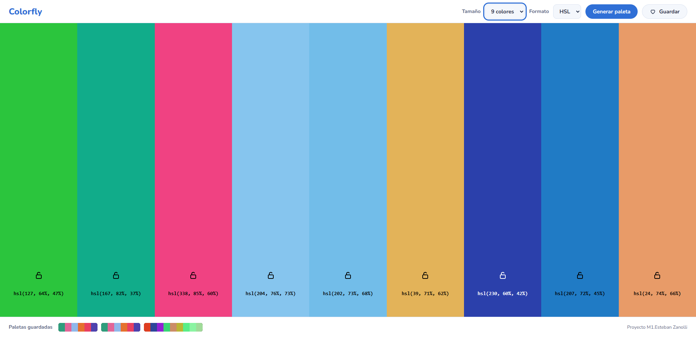
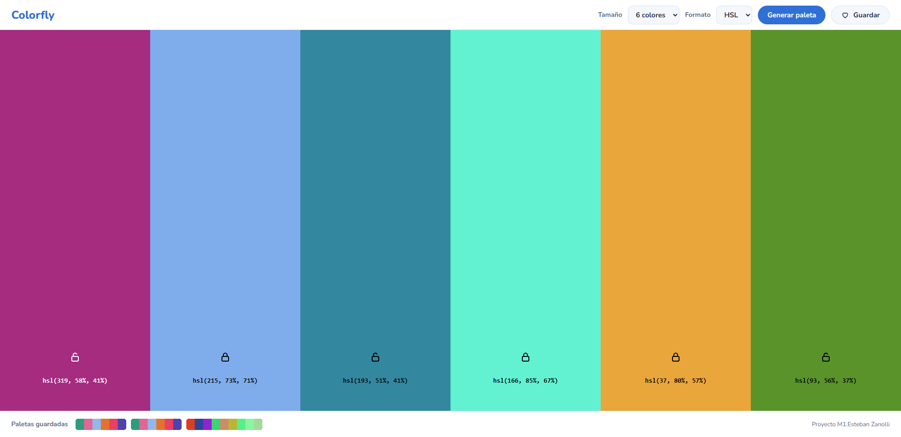
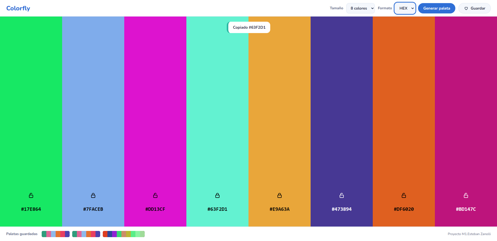
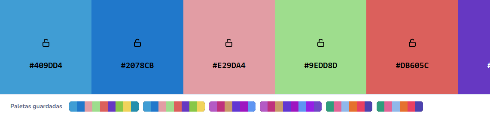
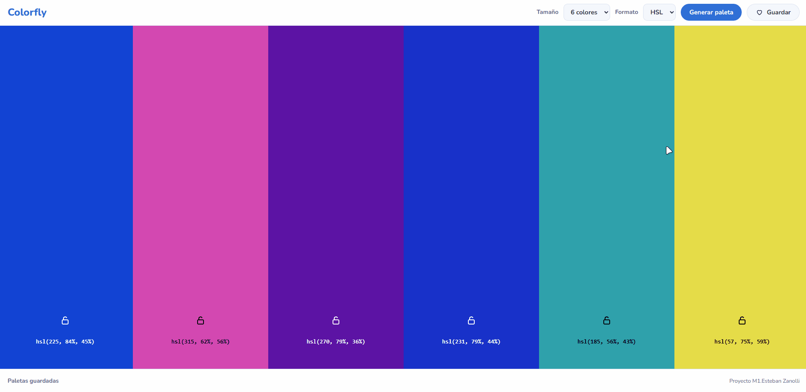

# 🎨 Colorfly - Generador de paletas

Proyecto Integrador del Módulo 1 (Full Stack + IA). App web que genera paletas de colores aleatorias con un clic, pensada para **Colorfly Studio**.

🔗 **Demo:** https://tatozan.github.io/ProyectoM1_EstebanZanolli/


## ✨ Qué hace

- 🎲 Genera colores aleatorios con el botón **Generar paleta**.
- 📐 Paletas de 6, 8 o 9 colores.
- 🏷️ Muestra cada color en **HSL** o **HEX**.
- 💬 Avisa cada acción con un mensaje (toast).
- 🌟 **Extras:** 🔒 bloquear colores con el candado, 💾 guardar hasta 6 paletas (`localStorage`), 📋 copiar el código con un clic y animaciones suaves.

## 🖱️ Cómo se usa

1. 📐 Elegí el tamaño y el formato.
2. 🎲 Hacé clic en **Generar paleta**.
3. 🔒 Tocá el candado de un color para conservarlo al generar de nuevo.
4. 📋 Hacé clic en un código para copiarlo.
5. 💾 Con **Guardar** la paleta queda abajo; hacé clic en ella para cargarla.

**Tamaño y formato** (paso 1): acá se ve una paleta de 9 colores en formato HSL.



| 🔒 Bloqueo (paso 3) | 📋 Copiar (paso 4) | 💾 Guardadas (paso 5) |
|---|---|---|
|  |  |  |

🎬 **Flujo completo:**



## 🛠️ Decisiones técnicas

- 🌈 **HSL como base:** genero el color en HSL y de ahí calculo el HEX. Limité saturación (45-85%) y luminosidad (35-75%) para evitar grises, neones y colores casi negros o blancos.
- 🧠 **Estado en un array:** cada color es un objeto (h, s, l, hex, bloqueado). Cada cambio redibuja la paleta con `dibujarPaleta()`.
- 👀 **Texto legible:** el texto de cada franja es blanco o negro según cuál contraste más (fórmula WCAG).
- 📏 **Cambiar el tamaño** conserva los colores que ya había y agrega los que faltan.
- 💾 **`localStorage`:** de cada color guardo solo h, s y l; el resto se recalcula al cargar.
- ♿ **Accesibilidad:** `label` en los selectores, foco visible, `aria-label` en los botones, aviso con `role="status"` y soporte de `prefers-reduced-motion`.
- 🧱 **Layout:** Grid para la página y la paleta, Flexbox para encabezado y controles. Sin estilos inline.
- ⚙️ **JavaScript:** funciones chicas, cada una con una sola tarea.

## 💻 Cómo ejecutarlo

No necesita instalar nada:

```bash
git clone https://github.com/tatozan/ProyectoM1_EstebanZanolli.git
```

Abrí `index.html` en el navegador (doble clic o con Live Server de VS Code).

## 🚀 Cómo desplegarlo en GitHub Pages

1. Subí los cambios: `git add .`, `git commit -m "mensaje"`, `git push origin master`.
2. En GitHub: **Settings → Pages**.
3. En **Source** elegí `Deploy from a branch`, rama `master` y carpeta `/ (root)`.
4. Guardá y esperá un par de minutos.

## 🗂️ Estructura

```
ProyectoM1_EstebanZanolli/
├── index.html
├── css/styles.css
├── js/script.js
├── capturas/
├── IA/
└── README.md
```

## 🤖 Uso de IA

La inteligencia artificial me ayudó a generar este proyecto de diversas maneras:
- **Asistencia en el código y accesibilidad:** Me guio para implementar mejoras en accesibilidad (foco visible, etiquetas descriptivas, contraste WCAG y soporte para reducir movimiento).
- **Reorganización del código:** Me asistió en el reordenamiento de las funciones dentro del archivo JavaScript y de las clases de estilo en styles.css para mantener ambos archivos prolijos y legibles.
- Los prompts, resultados y capturas detalladas de este proceso se encuentran en la carpeta [`IA/`](IA/)


## 👤 Autor

**Esteban Zanolli** - [@tatozan](https://github.com/tatozan) · HTML5, CSS3, JavaScript, Git y GitHub Pages
